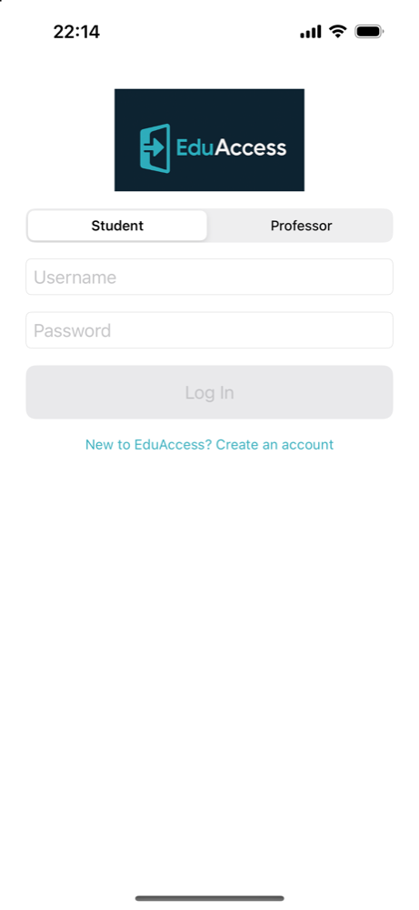
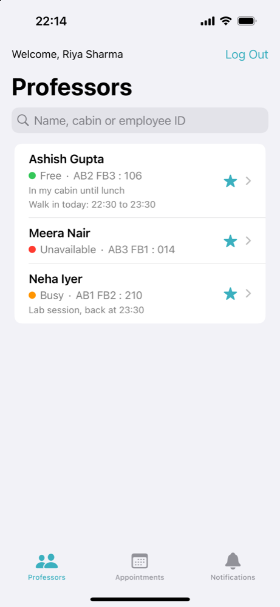
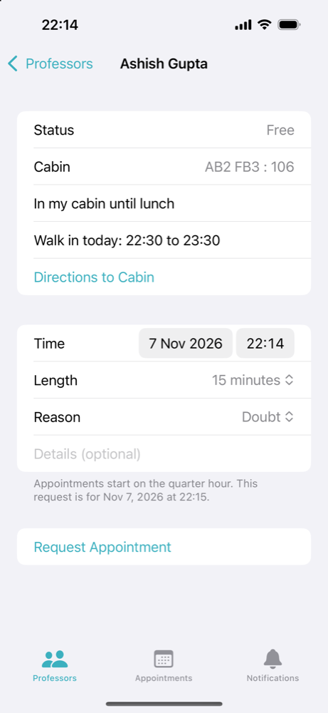
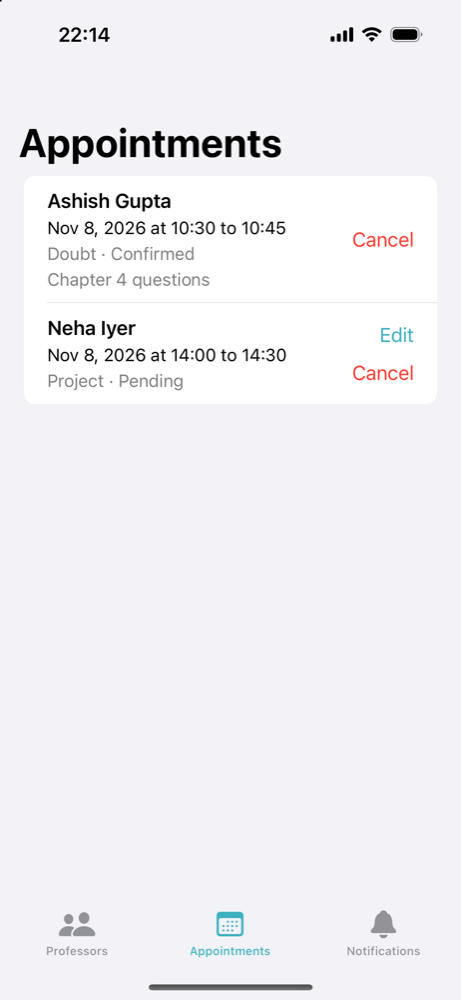
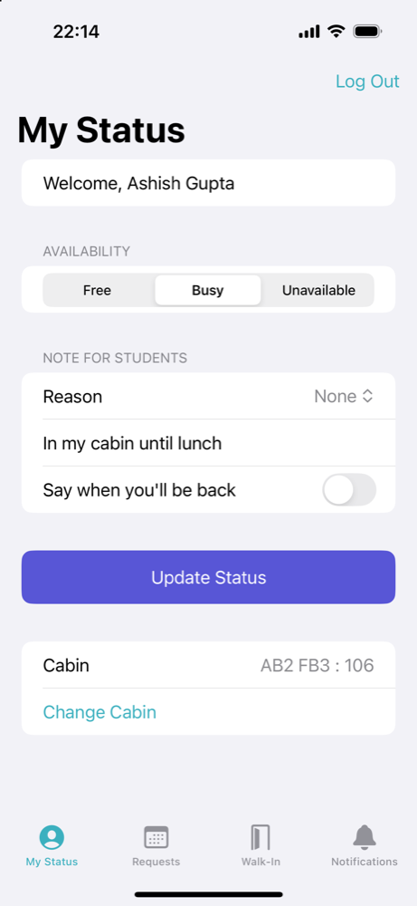
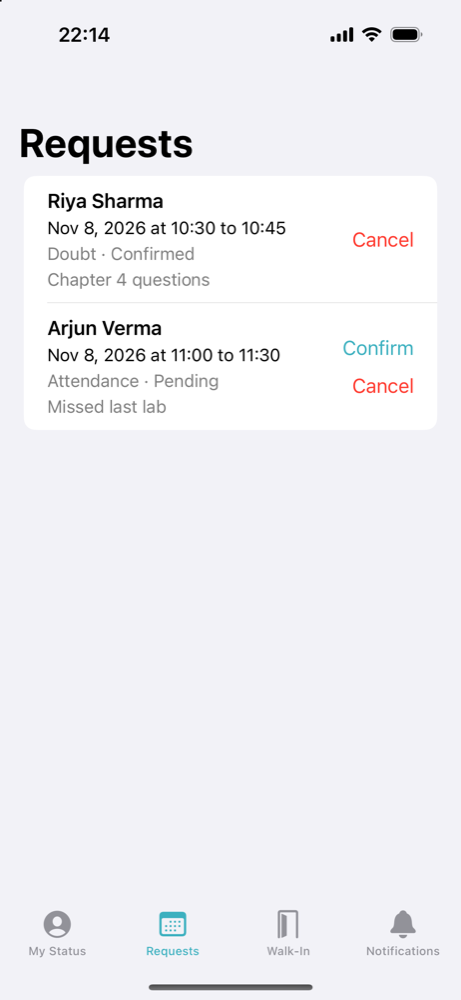

# EduAccess iOS

Students can see whether a professor is free before walking across campus, and book time with them. EduAccess iOS is the native SwiftUI client for the [EduAccess](https://github.com/lakshya110704/EduAccess) Django REST backend.

| Log in | Check professors | Request an appointment |
|---|---|---|
|  |  |  |

| Track appointments | Set your status | Handle requests |
|---|---|---|
|  |  |  |

Screenshots are from the iOS simulator with made-up demo data on a local backend.

## Features

**Students**

- See saved professors, or search all of them, with status (Free, Busy, Unavailable), note, cabin and today's walk-in hours
- Save and remove professors, and open cabin directions on the web app
- Request a 15 or 30 minute appointment with a time, a reason and optional details. Times round up to the quarter hour, as the backend requires
- See appointments with their start and end times, edit the reason while a request is pending, and cancel with a confirmation first

**Professors**

- Set a status with a note and a time they'll be back. The Update Status button appears only after a change
- Confirm or cancel requests. Confirming declines overlapping requests on the backend, and the list reloads to show that
- Add and remove walk-in time for today
- Set and change their cabin. Without one, they must set it before anything else, as on the website

**Both**

- Log in with the backend's session login (CSRF cookie plus form post), stay logged in between launches, and log out
- Request an account from the login screen. It shows every field's errors, scrolls to the first one, and says the account waits for an admin to activate it
- Availability and appointment lists refresh every 10 seconds while on screen, as the web app's dashboards do
- A notifications list, refreshed with the other lists
- Return to login with a message when the session ends, and show the backend's own message when it refuses a request
- Close the keyboard when tapping outside a text field, on every screen

## How it is built

- SwiftUI and Swift Concurrency, iOS 18.0 deployment target, no third-party dependencies
- MVVM: one `@Observable` view model per screen
- Views and view models depend on the `APIClient` protocol. `LiveAPIClient` talks to the backend with `URLSession`, and the tests use `MockAPIClient`
- The session cookie stays in the app's cookie storage, so a user stays logged in until they log out or the backend ends the session

```
EduAccess/
  Models/         Professor, Appointment, Me, OpenTime, AppNotification, CampusBlock, Signup, UserRole, AvailabilityStatus
  Networking/     APIClient protocol, LiveAPIClient
  ViewModels/     Login, Signup, Professors, Booking, Appointments, ProfessorStatus, ProfessorGate, Cabin, OpenTime, Notifications
  Views/          SwiftUI screens
EduAccessTests/   View model tests with a mock, client tests, tests against a local backend
EduAccessUITests/ Full flows through the real app against a local backend
```

## Run it

Start the backend from a checkout of [lakshya110704/EduAccess](https://github.com/lakshya110704/EduAccess). The app expects it at `http://127.0.0.1:8000`.

```bash
uv venv --python 3.12 .venv
uv pip install --python .venv/bin/python -r requirements.txt --no-deps
export DB_ENGINE=sqlite DJANGO_DEBUG=True
.venv/bin/python manage.py migrate
.venv/bin/python manage.py seed_demo
.venv/bin/python manage.py runserver 127.0.0.1:8000
```

`seed_demo` creates the accounts `student1`, `student2`, `prof1` and `prof2`. Their password is in `api/management/commands/seed_demo.py` in the backend. To add the campus blocks and cabin-less professors that sign-up and the cabin screen need, run this from the backend checkout:

```bash
.venv/bin/python manage.py shell < path/to/EduAccess-iOS/scripts/local_test_fixtures.py
```

Then open `EduAccess.xcodeproj` in Xcode and run the `EduAccess` scheme on an iOS 18 simulator. A new student has no saved professors, so search for one (for example `AB2` or `gupta`) and tap its star.

To use another backend, set the `API_BASE_URL` build setting in Xcode, or pass it on the command line. Plain HTTP only works for local addresses:

```bash
xcodebuild build -project EduAccess.xcodeproj -scheme EduAccess -destination 'generic/platform=iOS Simulator' API_BASE_URL=https://your-host.example CODE_SIGNING_ALLOWED=NO
```

## Tests

The suite has view model tests with a mock, client tests, tests against a local backend, and UI flows through the real app. The UI flows cover booking from both sides, the cabin requirement, sign-up, logging in under the wrong role, and closing the keyboard.

```bash
xcodebuild test -project EduAccess.xcodeproj -scheme EduAccess -destination 'platform=iOS Simulator,name=iPhone 16,OS=18.0' CODE_SIGNING_ALLOWED=NO
```

With the seeded backend running, supply its demo password to also run the tests that use it. They refuse any host but `127.0.0.1`, so they cannot write to a deployed backend.

```bash
TEST_RUNNER_EDUACCESS_TEST_PASSWORD=<seed_demo password> xcodebuild test -project EduAccess.xcodeproj -scheme EduAccess -destination 'platform=iOS Simulator,name=iPhone 16,OS=18.0' CODE_SIGNING_ALLOWED=NO
```

Last runs, on an iPhone 16 simulator with iOS 18.0 and Xcode 27.2:

| Run | App code | Passed | Failed | Skipped |
|---|---|---|---|---|
| Local backend over HTTP | Current | 132 | 0 | 0 |
| Local backend in production mode behind a TLS proxy, over HTTPS | Before the Update Status and keyboard changes | 128 | 0 | 0 |
| Fresh clone, no password | Before the Update Status and keyboard changes | 107 | 0 | 21 |

The sign-up UI flow is not fully stable. It sometimes fails when the app crashes inside `XCTAutomationSupport`, Xcode's test support library. The UI flows also retry dropped taps, which happened while the machine was under heavy load.

## Status

The app runs against a local backend and has been partly tested on an iPhone 18 Pro against the deployed backend. It is not on the App Store.

- **Confirmed on the deployed backend:** a wrong password being refused, a professor logging in, setting a cabin, and updating a status
- **Not yet run on the deployed backend:** student login, saving a professor, booking, confirming or cancelling, notifications with content, and in-app sign-up. These are tested against a local backend only, so parity with the website is not yet confirmed
- **Not yet run anywhere:** iPad, dark mode, VoiceOver, pull to refresh, tapping the directions link, and the app with the backend offline

## Limitations

- Sign-up and setting a cabin need backend commit `b9a5f97` or later, which is deployed. From reading the code, not from running it, older backends make both fail, and a professor with no cabin can't get past the cabin screen
- The backend has no JSON login endpoint, so the app posts its HTML login form. That form's wrong-role and awaiting-approval messages are only in its HTML, so the app shows one shared message for both
- Cabin directions open the website's page, which has the Maps link, 360 view, written steps and WhatsApp share. The backend has no API for a native screen
- There are no push notifications. The in-app list is what the website has. Push would need a paid Apple Developer account and backend work

## Contributors

- Lakshya Mehta
- Mohini

## License

MIT. See [LICENSE](LICENSE).
